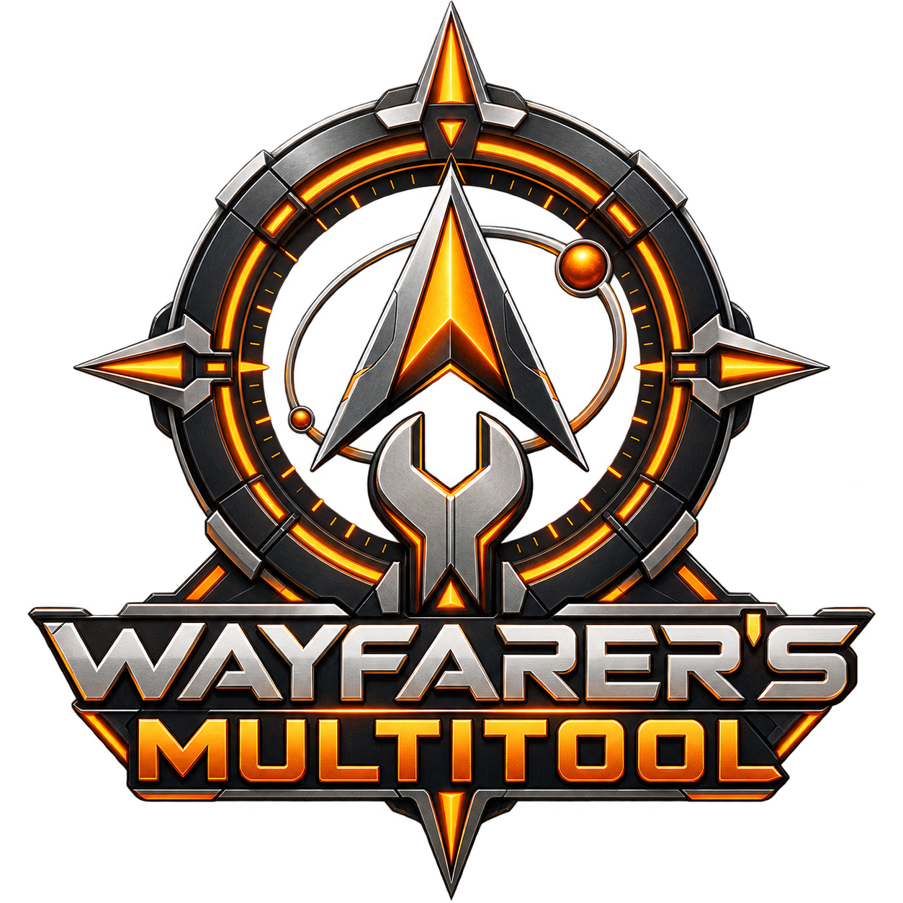

  

# Wayfarer's Multitool (WFMT)

## A long way from home

You drop out of supercruise at the far edge of a boxel nobody has charted. The scanner has already fired; you did not touch a key. An alert
flags an Earth-like world, and a card on the edge of your screen lists the bodies worth a probe run, best first.

Three jumps later you are on the surface, sampling a plant. A small radar shows where the last sample was and how far to move before the
next one counts. When the data is sold, the credits arrive and the ledger adds them up without being asked.

Back in the bubble, a colony site is waiting for steel and titanium. You open a shopping list, see what the ship in your hold already
covers, and find the one system that sells most of the rest. The route is a click away. On a quiet evening you check the merits for your
Power, the missions on your board and the faction you have been supporting, all from the same panel.

None of these tools are new or innovative. They have been in the community for years, in various forms, by various authors, each one a
dedicated commander and a member of a dedicated community of players.

I started putting these ideas together into a single tool, so that I did not have to keep up with the updates of many, and placed it on a
platform that has always served me well: EDMC. **Wayfarer's Multitool (WFMT)** is the result. It is a big project and not perfect, but it has
all of the bells and whistles I expect and always wanted.

I am sharing it with you all, and I would appreciate your feedback and suggestions.

## What WFMT is

WFMT is a free add-on for **Elite Dangerous**, open to anyone who wants it.

- **What it covers:** Powerplay, exploration, mining, trading, missions, on-foot and cargo tracking, colonization, the BGS and more.
- **Where it runs:** inside [EDMC](https://github.com/EDCD/EDMarketConnector) (Elite Dangerous Market Connector), a free companion program
  many commanders already use, on Windows and Linux.
- **What you need to know:** nothing about programming.

**Version 1.2.0** is the latest release, published on 2026-10-28. It adds an archive for finished Colonization sites, an offer to create a Raven Colonial project for a new site, a Where to Buy window of its own, a Copy To Acquire list, clearer Biology overlay rows and a brighter footer message, and fixes Create Project on Raven and the snapping of large boxes in the layout editor. 1.1.0 was published on 2026-10-27 and 1.0.0, the first release, on 2026-10-26.

## Contents

- [A long way from home](#a-long-way-from-home)
- [What WFMT is](#what-wfmt-is)
- [Download and install](#download-and-install)
- [What's in the multitool](#whats-in-the-multitool)
- [Finding your way around](#finding-your-way-around)
- [About WFMT](#about-wfmt)
- [How WFMT knows what it knows](#how-wfmt-knows-what-it-knows)
- [Known issues](#known-issues)
- [Getting help](#getting-help)
- [All the guides](#all-the-guides)
- [For developers, credits and license](#for-developers-credits-and-license)

## Download and install

Getting started takes a few minutes, and nothing needs compiling. If EDMC is already on your computer, you are most of the way there.

### Windows and Linux

1. Download **`Wayfarers-Multitool.zip`** from the [latest release](https://github.com/rwharpernc/wayfarers-multitool/releases/latest). (The
   green **Code → Download ZIP** button is the source code, not the plugin.)
2. In EDMC open **File → Settings → Plugins → Open** and extract the ZIP there, so you end up with `plugins/Wayfarers-Multitool/load.py`.
3. Restart EDMC. The **Wayfarer's Multitool (WFMT)** panel appears. Settings are under **File → Settings → WFMT**.

### On Linux

EDMC needs a few settings first (the journal folder, `xdotool`, Flatpak permissions): see [WFMT on Linux](docs/guide/linux.md). For on-screen
displays, Windows has a built-in overlay and Linux uses [EDMCModernOverlay](https://github.com/SweetJonnySauce/EDMCModernOverlay).

### Updating

Extract the new ZIP over the old folder without deleting it first, or turn on **Automatically download and install updates** under
**Settings → WFMT → General → Updates**. Full instructions, with folders for each system, removing WFMT and building from source, are in
[docs/INSTALL.md](docs/INSTALL.md).

## What's in the multitool

WFMT is one panel with eight **modes**, and you click a button to switch between them. Each mode is a small toolbox for one way of playing,
and each has a guide that explains every button.

### The eight modes

| Mode (button) | What it's for | Guide |
|---|---|---|
| **Powerplay** (**P.P.**) | Merits and Control Points for your Power; a rare goods finder. | [Powerplay](docs/guide/powerplay.md) |
| **Exploration** (**EXP**) | Auto-honk, discovery alerts, boxel survey, scan values, exobiology, Codex tally, notes, expeditions, ship and carrier route planners, a dashboard window, a surface compass. | [Exploration](docs/guide/exploration.md), [Exobiology](docs/guide/exobiology.md) |
| **Mining** (**MIN**) | Space and surface mining runs, a book of rings and a book of deposits, Mining History, mining alerts. | [Mining](docs/guide/mining.md) |
| **Trade** (**TRD**) | Profit after fuel and repairs, fleet carrier cargo, saved sessions, best routes and prices, a watch list. | [Trade](docs/guide/trade.md) |
| **Missions** (**MSN**) | Every mission in one view, progress bars, a Missions window, where to buy the cargo. | [Missions](docs/guide/missions.md) |
| **Field Ops** (**OPS**) | Screenshots, backpack and cargo, materials, a blueprint browser, material traders, ship builds. | [Field Ops](docs/guide/field-ops.md) |
| **Colonization** (**COL**) | Your current build, history, an archive of finished sites, and every site's shopping list. | [Colonization](docs/guide/colonization.md) |
| **BGS** (**BGS**) | Faction states and what your activity does to them. | [BGS](docs/guide/bgs.md) |

### Always on

Four more tools work in the background and belong to no mode: **Landing Assist**, **Interdiction Warning**, **Flight Alerts** and the
**Route overlay** ([guide](docs/guide/always-on.md)).

### Looking for something specific?

[Features at a glance](docs/guide/features.md) lists every feature with the buttons to press, and starts with an "I want to…" table that
points to the right guide.

### Colonization is a work in progress

Colonization is the newest part of the game, and WFMT is still growing into it.

- Working today: the COL page, the Sites window, My Projects (your projects on Raven Colonial), starting a Raven project for a site, Where to
  buy (with the best single systems for a whole list), and the shopping-list overlay.
- Planned: co-op building and colony tracking.
- Until then, everything on the COL page is about **you**.

## Finding your way around

The modes differ, but the habits carry over. Learn these once and they work everywhere:

- **Mode buttons** at the top switch modes; the panel remembers where you were. **Hover** over any button for its full name
  ([button names](docs/guide/getting-started.md#button-names)).
- **◀ ▶** page between a mode's pages. **Click a section's title** to fold or unfold it.
- **Pop-out windows** open from panel buttons, remember their size and place, and close with **Esc**
  ([the list](docs/guide/getting-started.md#opening-the-pop-out-windows)).
- **Copy buttons** put a system name on the clipboard for the galaxy map search. System-name boxes suggest as you type.
- **Settings** are under **File → Settings → WFMT**, one tab per feature. Alerts, overlays and online lookups are **off until you turn them
  on**.
- **Each commander's data is separate**, and playing with EDMC closed is fine: WFMT catches up from your journals when EDMC starts.
- **Help and backups** are under **Settings → WFMT → General**: **Report an issue**, **Copy diagnostics**, **Back up my data**.

More: [Tips, quirks and workarounds](docs/guide/tips.md) · [Planned and being researched](docs/guide/planned.md).

## About WFMT

WFMT is built around the author's own ways of playing: exploring, mining, trading, colonizing and Powerplay. Elite Dangerous has a long line
of community tools, and [docs/ATTRIBUTIONS.md](docs/ATTRIBUTIONS.md) credits the projects and data that helped.
[THIRD-PARTY-NOTICES.md](THIRD-PARTY-NOTICES.md) carries the licenses for any data included.

If a workflow feels clumsy, a window is hard to read, or your playstyle is missing, please say so on the
[issue tracker](https://github.com/rwharpernc/wayfarers-multitool/issues).

## How WFMT knows what it knows

Like every third-party tool for Elite Dangerous, WFMT only knows what the game writes to its journal files, and not everything is logged.
That shapes everything WFMT can show you, so it is worth a minute to see where its numbers come from.

Where the journal is silent, WFMT uses three layers, in this order:

1. **The journal.** Everything WFMT shows about *you* starts here. If the game doesn't write it down, WFMT can't see it.
2. **Other places that know more.** Frontier's servers (through a signed-in EDMC) and community services:
   [Spansh](https://spansh.co.uk), [EDSM](https://www.edsm.net), Canonn, edastro, [Raven Colonial](https://ravencolonial.com). These fill
   gaps and never replace the journal. Each is listed on the [internet page](docs/guide/internet-and-privacy.md).
3. **Workarounds, marked as such.** WFMT's own bookkeeping, estimates labeled as estimates, and steps you can take (such as opening Carrier
   Management so the game reports the figure).

Each guide ends with a table of what the game does and doesn't tell us, and how to work around it. If a number looks wrong, start there.

## Known issues

Most commanders will never meet these, but they are the ones people do run into. The full list, with the fix for each, is in
[Known issues](docs/guide/known-issues.md).

### Overlays

- **Linux: right-hand overlay cards stop a little short of the screen edge.**
  - Fix: with a Flatpak EDMC, grant the Graphics folder permission and set **Display scaling** on Overlay Placement
    ([details](docs/guide/known-issues.md#right-hand-cards-stop-a-little-short-of-the-screen-edge-linux-edmcmodernoverlay)).
- **Overlay text looks doubled or ghosted** (EDMCModernOverlay only).
  - Cause: an old overlay window is still running.
  - Fix: end the older `overlay_client` processes and restart EDMC
    ([details](docs/guide/known-issues.md#overlay-text-looks-doubled-or-ghosted)).
- **Overlay text is all capitals** (EDMCModernOverlay only).
  - Fix: pick another font under **Settings → WFMT → Overlays → Appearance → Overlay font**.

### Screenshots

- **Windows: screenshots do not save.**
  - Cause: Controlled Folder Access or your antivirus may be blocking EDMC.
  - Fix: allow it, or choose another folder.

### Linux support

Linux support is a commitment. The author uses both Linux and Windows.

New features are proven on Windows first and Linux follows slightly behind. What is still to check is in
[Linux testing](docs/LINUX_TESTING.md).

## Getting help

Found a bug? The plugin can start the report for you, so you do not have to remember what to include.

1. Open **File → Settings → WFMT → General → Help**.
2. Press **Copy diagnostics**. This copies your versions and the matching log lines to the clipboard.
3. Press **Report an issue**. This opens a bug report in your browser with your versions already filled in.
4. Paste the diagnostics into the log box, read the form through, and submit it.

Step by step, with what is and isn't included: [Reporting a problem](docs/guide/reporting-problems.md).

### Reporting by hand

You can also open an issue on the [Issues page](https://github.com/rwharpernc/wayfarers-multitool/issues):

- Say what you were doing, what you expected and what happened.
- EDMC's log helps a lot.
- Something looks wrong? Try [Troubleshooting](docs/guide/troubleshooting.md) first.

### Ideas and feedback

Ideas, comments on how WFMT feels to use, and suggestions for other playstyles belong on the same Issues page.

## All the guides

Everything is written for players, in plain language. Pick the group that matches what you need:

- **Set up:** [Installing WFMT](docs/INSTALL.md) · [Getting started](docs/guide/getting-started.md) ·
  [Windows and Linux](docs/guide/platforms.md) · [WFMT on Linux](docs/guide/linux.md) · [Overlay setup](docs/OVERLAY_SETUP.md) ·
  [What goes on the internet](docs/guide/internet-and-privacy.md)
- **Use it:** [Features at a glance](docs/guide/features.md) · [full guide index](docs/guide/README.md)
- **When something's wrong:** [Known issues](docs/guide/known-issues.md) · [Troubleshooting](docs/guide/troubleshooting.md) ·
  [Linux testing](docs/LINUX_TESTING.md)

## For developers, credits and license

If you want to see how WFMT works, build it or change it, start here.

### Building and understanding it

- [docs/INSTALL.md](docs/INSTALL.md): installing, updating and building from source.
- [docs/DEVELOPMENT.md](docs/DEVELOPMENT.md): setting up to build, test and change WFMT.
- [docs/TECHNICAL.md](docs/TECHNICAL.md): how WFMT works and why. [docs/DESIGN_NOTES.md](docs/DESIGN_NOTES.md): the reasoning behind the
  main decisions. [docs/MODULES.md](docs/MODULES.md): every module in `plugin/`.
- **Feature specifications:** [Missions](docs/MISSIONS_TECH_SPEC.md), [Mining](docs/MINING_TECH_SPEC.md), [Trade](docs/TRADE_TECH_SPEC.md),
  [Boxel Survey](docs/BOXEL_SURVEY_TECH_SPEC.md), [BGS](docs/BGS_TECH_SPEC.md),
  [Organic Scanning](docs/ORGANIC_SCANNING_TECH_SPEC.md), [Powerplay](docs/POWERPLAY_TECH_SPEC.md),
  [Screenshots and input automation](docs/SCREENSHOTS_AND_INPUT_TECH_SPEC.md).
- [CHANGELOG.md](CHANGELOG.md): what changed in each version.

### Credits and license

WFMT stands on a lot of community work. [docs/ATTRIBUTIONS.md](docs/ATTRIBUTIONS.md) has the thanks and acknowledgements, chapter by chapter.

Built and maintained by R.W. Harper: CMDR Tiber Caelvox.

Copyright (c) 2026 R.W. Harper. Released under the [GNU General Public License v3.0](LICENSE). Third-party notices are in
[THIRD-PARTY-NOTICES.md](THIRD-PARTY-NOTICES.md).

*Elite Dangerous* is a trademark of Frontier Developments plc. WFMT is a fan-made tool and is not official Frontier software.
