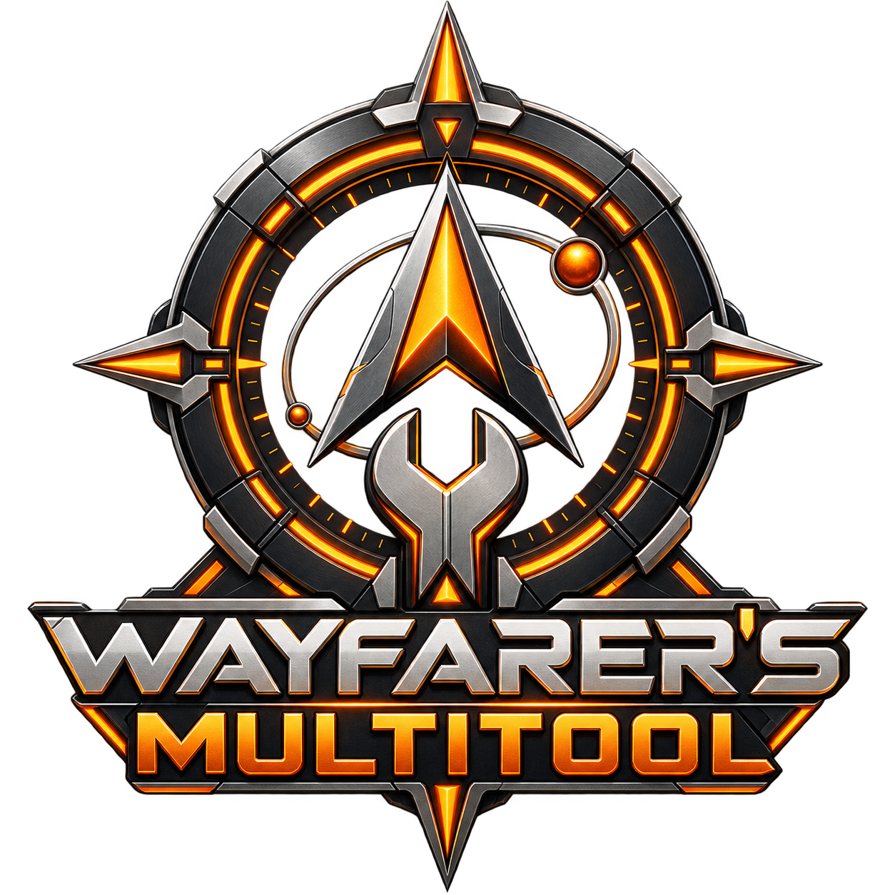

  

# Wayfarer's Multitool (WFMT)

Wayfarer's Multitool (WFMT) is a free plugin for [EDMC](https://github.com/EDCD/EDMarketConnector) (Elite Dangerous Market Connector). It reads the *Elite Dangerous* journal and presents exploration, exobiology, mining, trading, missions, colonization, Powerplay and BGS tools in a single panel. It runs on Windows and Linux.

This page is the overview. Each feature has a guide in [`docs/guide`](docs/guide/README.md). The first guide to read is [Getting started](docs/guide/getting-started.md).

## Contents

1. [Overview](#overview)
2. [Download and install](#download-and-install)
3. [The eight modes](#the-eight-modes)
4. [Always-on tools](#always-on-tools)
5. [Finding your way around](#finding-your-way-around)
6. [How WFMT knows what it knows](#how-wfmt-knows-what-it-knows)
7. [Known issues](#known-issues)
8. [Getting help](#getting-help)
9. [All the guides](#all-the-guides)
10. [For developers, credits and license](#for-developers-credits-and-license)

## Overview

WFMT combines tools that the Elite Dangerous community has built in various forms over several years into one EDMC plugin, so that a commander maintains one plugin instead of many. Feedback and suggestions are accepted on the [Issues page](https://github.com/rwharpernc/wayfarers-multitool/issues).

### At a glance

| | |
|---|---|
| **What it is** | A free plugin for **Elite Dangerous** that runs inside EDMC |
| **What it covers** | Powerplay, exploration and exobiology, mining, trading, missions, on-foot and cargo tracking, colonization, the BGS, sharing reports to Discord |
| **Where it runs** | Inside [EDMC](https://github.com/EDCD/EDMarketConnector), on Windows and Linux |
| **Latest release** | **1.5.2**, published 2026-11-04 ([changelog](CHANGELOG.md)) |
| **Cost and privacy** | Free. On-screen overlays, alerts and online lookups are off until enabled in Settings. [What goes on the internet](docs/guide/internet-and-privacy.md) lists every online lookup |

## Download and install

1. Download **`Wayfarers-Multitool.zip`** from the [latest release](https://github.com/rwharpernc/wayfarers-multitool/releases/latest), under **Assets**. The **Code → Download ZIP** button on GitHub provides the source code, which EDMC cannot load as a plugin.
2. In EDMC, open **File → Settings → Plugins** and select **Open** to show the plugins folder. Extract the ZIP into it, so that `plugins/Wayfarers-Multitool/load.py` exists.
3. Restart EDMC. The **Wayfarer's Multitool (WFMT)** panel appears. Settings are under **File → Settings → WFMT**.

**Linux.** EDMC requires configuration before most features read data: the journal folder, `xdotool` and, for a Flatpak EDMC, folder permissions. See [WFMT on Linux](docs/guide/linux.md).

**Overlay.** Windows provides a built-in overlay for on-screen displays. Linux requires [EDMCModernOverlay](https://github.com/SweetJonnySauce/EDMCModernOverlay).

**Update.** Extract the new ZIP over the existing `Wayfarers-Multitool` folder without deleting the folder first, or enable **Automatically download and install updates** under **Settings → WFMT → General → Updates**.

[Installing WFMT](docs/INSTALL.md) lists the plugin folder of each system, removal, and building from source.

## The eight modes

The panel has eight modes. A mode button switches between them. Each mode has its own guide.

| Mode (button) | Scope | Guide |
|---|---|---|
| **Powerplay** | Merits and Control Points for the commander's Power, a rare goods finder, sharing progress to Discord | [Powerplay](docs/guide/powerplay.md) |
| **Explore** | Auto-honk, discovery alerts, Boxel Survey, scan values, Codex tally, notes, expeditions, route planners, a dashboard, a surface compass | [Exploration](docs/guide/exploration.md) |
| **Exobiology** (in **Explore**) | Species prediction, sample tracking, a sample radar, overlay cards for the current body | [Exobiology](docs/guide/exobiology.md) |
| **Mine** | Space and surface mining, a book of rings and deposits, Mining History, mining alerts | [Mining](docs/guide/mining.md) |
| **Trade** | Profit after fuel and repairs, fleet carrier cargo, saved sessions, best routes and prices, a watch list | [Trade](docs/guide/trade.md) |
| **Mission** | All missions in one view, progress bars, a Missions window, sources for mission cargo | [Missions](docs/guide/missions.md) |
| **Operations** | Screenshots, backpack and cargo, engineering materials, blueprints and wishlist, engineers, material traders, ship builds, the combat record, your ranks | [Operations](docs/guide/operations.md) |
| **Colony** (Colonization) | The current build, history, an archive of finished sites, the shopping list of each site | [Colonization](docs/guide/colonization.md) |
| **BGS** | Faction states and the effect of the commander's activity; sharing a tick's report to Discord | [BGS](docs/guide/bgs.md) |

### Sharing reports

The BGS report and Powerplay progress can be shared in three ways: copied as plain text, copied with Discord formatting, or posted to a Discord webhook.

- Posting follows a button press only. The posting switch is off until enabled.
- A webhook belongs to one channel. Each commander saves a named list of destinations, and **Post to Discord** asks which one to use when there are several. Commanders can copy each other's lists.
- Posting requires neither Discord to be open nor membership in the channel. Posting the same report again edits the earlier post.
- A customize dialog provides presets (Standard, Compact, Detailed, Plain), checkboxes for the parts of a post, a live preview, and saved templates.
- Webhook links are saved on the local computer for each commander, are excluded from backups, and are not logged.

[Sharing reports to Discord](docs/guide/discord.md) describes the procedure, including webhook creation, thread ids and post naming.

[Features at a glance](docs/guide/features.md) lists every feature with its controls and begins with a table that maps tasks to guides.

### Colonization status

Colonization is under development. Implemented: the Colony page, the Sites window, My Projects (the commander's Raven Colonial projects), starting a Raven project for a site, Where to buy (including a shopping route for a whole list), and the shopping-list overlay.

## Always-on tools

Four tools run in the background and belong to no mode: **Landing Assist**, **Interdiction Warning**, **Flight Alerts** and the **Route overlay**. See [Always-on tools](docs/guide/always-on.md).

## Finding your way around

| Task | Procedure |
|---|---|
| Switch modes | Select a mode button at the top of the panel. The panel remembers the last position |
| Identify a button | Hover over it for its name and function ([button names](docs/guide/getting-started.md#button-names)) |
| Open a page of a mode | Select the page's button to open it in its own window. Select a section title to fold or unfold the section |
| Open a pop-out window | Select its panel button. Windows remember size and position and close with **Esc** ([list](docs/guide/getting-started.md#opening-the-pop-out-windows)) |
| Search the galaxy map | Use a copy button to place a system name on the clipboard. System-name boxes suggest names while typing |
| Change a setting | A setting that belongs to a window is in that window and is saved on change. Switches that allow contact with another service, overlays and General are in **File → Settings → WFMT**, one tab per feature |
| Separate commanders | Data is stored per commander. When EDMC is closed during play, WFMT reads the journals at the next EDMC start |
| Get help or save data | **Settings → WFMT → General**: **Report an issue**, **Copy diagnostics**, **Back up my data** |

See also [Tips, quirks and workarounds](docs/guide/tips.md) and [Planned and being researched](docs/guide/planned.md).

## How WFMT knows what it knows

WFMT uses the data the game writes to its journal files. Not every event is logged. Where the journal has no data, WFMT uses three layers in this order:

1. **The journal.** All data about the commander originates here.
2. **Other sources.** Frontier's servers (through a signed-in EDMC) and community services: [Spansh](https://spansh.co.uk), [EDSM](https://www.edsm.net), Canonn, edastro and [Raven Colonial](https://ravencolonial.com). These fill gaps and do not replace the journal.
3. **Marked workarounds.** WFMT's own bookkeeping, estimates labeled as estimates, and actions the commander can take (for example, opening Carrier Management so that the game reports the figure).

Each mode guide ends with a table of what the game does and does not report, and the workaround for each gap.

## Known issues

[Known issues](docs/guide/known-issues.md) lists all entries. The most common:

| Where | Symptom | Remedy |
|---|---|---|
| Linux overlay | Right-hand cards stop short of the screen edge | With a Flatpak EDMC, grant the Graphics folder permission and set **Display scaling** on Overlay Placement ([details](docs/guide/known-issues.md#right-hand-cards-stop-a-little-short-of-the-screen-edge-linux-edmcmodernoverlay)) |
| EDMCModernOverlay | Text appears doubled or ghosted | An older overlay window is still running. End the older `overlay_client` processes and restart EDMC ([details](docs/guide/known-issues.md#overlay-text-looks-doubled-or-ghosted)) |
| EDMCModernOverlay | Text is all capitals | Select another font under **Settings → WFMT → Overlays → Appearance → Overlay font** |
| Windows screenshots | Screenshots are not saved | Controlled Folder Access or an antivirus program may block EDMC. Allow EDMC or choose another folder |

Linux is a supported platform. Features are verified on Windows first. The Linux status is in [Linux testing](docs/LINUX_TESTING.md).

## Getting help

1. Open **File → Settings → WFMT → General → Help**.
2. Select **Copy diagnostics**. This copies version information and the matching log lines to the clipboard.
3. Select **Report an issue**. This opens a bug report in the browser with the versions filled in.
4. Paste the diagnostics into the log box, review the form and submit it.

- [Reporting a problem](docs/guide/reporting-problems.md) lists what the diagnostics include and exclude.
- Where WFMT cannot verify a fact (for example an engineer's invitation requirements), **Settings → WFMT → General → Help → Report game data** or **Report engineer data** on the Engineers tab opens a GitHub form. Nothing is sent until the form is submitted.
- **Write a separate diagnostic log** on the same Help tab records more detail than EDMC's log.
- Issues can also be opened on the [Issues page](https://github.com/rwharpernc/wayfarers-multitool/issues). Include the action taken, the expected result, the actual result and EDMC's log.
- [Troubleshooting](docs/guide/troubleshooting.md) lists symptoms and remedies.
- Suggestions are accepted on the same Issues page.

## All the guides

| Topic | Documents |
|---|---|
| **Set up** | [Installing WFMT](docs/INSTALL.md) · [Getting started](docs/guide/getting-started.md) · [Windows and Linux](docs/guide/platforms.md) · [WFMT on Linux](docs/guide/linux.md) · [Overlay setup](docs/OVERLAY_SETUP.md) · [What goes on the internet](docs/guide/internet-and-privacy.md) |
| **Use a feature** | [Features at a glance](docs/guide/features.md) · [guide index](docs/guide/README.md) · the mode guides in [The eight modes](#the-eight-modes) |
| **Fix a problem** | [Known issues](docs/guide/known-issues.md) · [Troubleshooting](docs/guide/troubleshooting.md) · [Linux testing](docs/LINUX_TESTING.md) |
| **Reference** | [Tips, quirks and workarounds](docs/guide/tips.md) · [Planned and being researched](docs/guide/planned.md) |

## For developers, credits and license

- [docs/INSTALL.md](docs/INSTALL.md): installing, updating and building from source.
- [docs/DEVELOPMENT.md](docs/DEVELOPMENT.md): building, testing and changing WFMT.
- [docs/TECHNICAL.md](docs/TECHNICAL.md): architecture. [docs/DESIGN_NOTES.md](docs/DESIGN_NOTES.md): design decisions. [docs/MODULES.md](docs/MODULES.md): every module in `plugin/`.
- Feature specifications: [Missions](docs/MISSIONS_TECH_SPEC.md), [Mining](docs/MINING_TECH_SPEC.md), [Trade](docs/TRADE_TECH_SPEC.md), [Boxel Survey](docs/BOXEL_SURVEY_TECH_SPEC.md), [BGS](docs/BGS_TECH_SPEC.md), [Organic Scanning](docs/ORGANIC_SCANNING_TECH_SPEC.md), [Powerplay](docs/POWERPLAY_TECH_SPEC.md), [Screenshots and input automation](docs/SCREENSHOTS_AND_INPUT_TECH_SPEC.md).
- [CHANGELOG.md](CHANGELOG.md): changes in each version.
- [docs/ATTRIBUTIONS.md](docs/ATTRIBUTIONS.md): acknowledgements by chapter. [THIRD-PARTY-NOTICES.md](THIRD-PARTY-NOTICES.md): licenses of included data.

### Reuse of WFMT's ideas and code

- **Ideas** (how a feature works, how it looks, how data is read) may be reused without permission.
- **Code** is released under the [GNU General Public License v3.0](LICENSE). It may be copied, changed and redistributed, in free or paid software, provided that the redistributed work is also under GPL-3.0 with its source available and that the copyright and license notices are kept.
- **Attribution** (a line in a README, credits or a post) is welcome and is required only to the extent of those notices.
- **Included data** keeps the license of its compiler, listed in [THIRD-PARTY-NOTICES.md](THIRD-PARTY-NOTICES.md).

See [docs/ATTRIBUTIONS.md](docs/ATTRIBUTIONS.md#included-data-and-reusing-wfmt).

Author and maintainer: R.W. Harper (CMDR Mactavious).
Copyright (c) 2026 R.W. Harper.
Released under the [GNU General Public License v3.0](LICENSE).

*Elite Dangerous* is a trademark of Frontier Developments plc. WFMT is a fan-made tool and is not official Frontier software.
